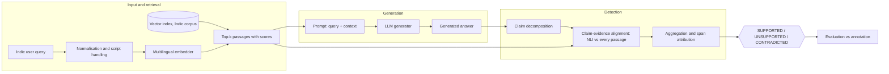

# Hallucination Detection in RAG for Low-Resource Indic Languages

[](https://github.com/YousufFFFF/indic-rag-hallu/actions/workflows/ci.yml)

A claim-level framework that checks whether an LLM answer in an Indian language is actually supported by the passages retrieved for it, with span-level attribution.

> **The detector never asks "is this true?". It asks "does the retrieved evidence say this?"**
> Every claim either points at the retrieved passage that supports or contradicts it, or is marked unsupported. Retrieval scores are carried through every stage, so a retrieval failure can be told apart from a generation failure.

Final-year B.E. (AI & Data Science) project, JSPM's Narhe Technical Campus, Pune, 2026–27: Mohammed Yousuf Ansari, Mukta Dhage, Sneha Shinde, Srushti Kondhalkar.

**Status:** M0, the Hindi vertical slice (pilot). Languages in scope: Hindi, Bengali, Tamil, Telugu, Marathi, Kannada, Malayalam, Gujarati, Punjabi (`configs/languages.yaml`); M0 enables Hindi. See [`docs/PLAN.md`](docs/PLAN.md) for the plan and [`docs/PROGRESS.md`](docs/PROGRESS.md) for the log.

## How it works



Every text transformation (NFC, IndicNLP, Indic digits, sentence splitting) keeps an **offset map** back to the original string, so spans are always reported on the original answer text.

| Stage | Code |
|---|---|
| Normalisation, digits, sentences, tokens, offset maps | `src/indichallu/text/` |
| Data: IndicQA download (pinned + SHA-256), loader, leakage-free split, synthetic errors | `src/indichallu/data/` |
| Retrieval: embedder, FAISS index, top-k with scores / ranks / gold flags | `src/indichallu/retrieval/` |
| Generation: Hindi prompt, Ollama / OpenAI-compatible backends, cache | `src/indichallu/generation/` |
| Detection: decompose → align (NLI) → aggregate; baseline B1 | `src/indichallu/detection/` |
| Metrics: Recall@k / nDCG / MRR, P/R/F1 / balanced accuracy / AUROC, span F1 / token IoU / exact match, per-language and worst-language | `src/indichallu/eval/` |

## M0 results

<!-- BEGIN AUTO: m0-results -->
_Generated by `scripts/make_tables.py` from `results/m0/pilot.json` (run `20261121-102839-m0-pilot-03dcc971`, commit `ff41974`). **pilot — synthetic Hindi data only.**_

Retrieval: `intfloat/multilingual-e5-small` over the Hindi IndicQA corpus (test questions, n = 315). NLI: `MoritzLaurer/mDeBERTa-v3-base-xnli-multilingual-nli-2mil7` (device: cuda). Pilot set: 164 val / 176 test records (faithful vs injected NUMERICAL/TEMPORAL errors); thresholds tuned on val only.

| Retrieval (test) | Recall@1 | Recall@3 | Recall@5 | Recall@10 | nDCG@10 | MRR |
|---|---:|---:|---:|---:|---:|---:|
| `me5-small` | 0.517 | 0.683 | 0.746 | 0.803 | 0.660 | 0.614 |

| Detection (pilot test) | Precision | Recall | Response F1 | Balanced acc. | AUROC | Span F1 | Token IoU | Exact-span F1 | Thresholds (entail / contradict) |
|---|---:|---:|---:|---:|---:|---:|---:|---:|---|
| Ours (decompose → align → aggregate) | 0.900 | 0.102 | 0.184 | 0.545 | 0.735 | 0.039 | 0.029 | 0.000 | 0.10 / 0.05 |
| B1 sentence-level NLI | 0.833 | 0.114 | 0.200 | 0.545 | 0.673 | 0.032 | 0.024 | 0.000 | 0.10 / 0.05 |

Reference: flagging every answer as hallucinated gives response F1 0.667 on this test set (88 of 176 records hallucinated).

| Span F1 by error type (pilot test) | Ours (decompose → align → aggregate) | B1 sentence-level NLI |
|---|---:|---:|
| NUMERICAL | 0.036 | 0.036 |
| TEMPORAL | 0.030 | 0.025 |
| ENTITY | — | — |
| LOCATION | — | — |

ENTITY/LOCATION are not injected in M0 (needs IndicNER), so they show —.
<!-- END AUTO: m0-results -->

**How to read the pilot** (prose only; every number is in the generated block above):

- **What works:** faithful answers are almost always recognised as SUPPORTED, and claim decomposition ranks answers better than sentence-level NLI (AUROC column).
- **What doesn't yet:** the off-the-shelf multilingual NLI model mostly *entails* a sentence whose number or date was changed, so most injected errors pass as SUPPORTED (low recall). Catching them is the job of the typed NUMERICAL/TEMPORAL verifiers planned for M1 (contribution C2).
- **Why span F1 is near zero:** predictions are whole claims, gold spans are the changed number or date, and the thresholds are tuned on character-level span F1 (DECISIONS D-024), which then favours flagging almost nothing. The M1 tuning objective will be fixed before M1's evaluation, not adjusted on these test results.
- **Scope:** synthetic Hindi data with automatic labels; faithful answers are copied from the evidence, so this set is easier than natural generations (DECISIONS D-025).

## Quickstart

Everything runs in Docker; no local Python install is needed (Docker Desktop with Compose v2).

```sh
docker compose build                                            # Python 3.11, CPU PyTorch, pinned deps
docker compose run --rm dev pytest                              # test suite (CPU, no downloads)
docker compose run --rm dev python scripts/download_indicqa.py  # Hindi IndicQA, pinned + verified
docker compose run --rm dev python scripts/run_pilot_eval.py --embedder me5-small   # M0 pilot run
docker compose run --rm dev python scripts/make_tables.py       # regenerate the table above
```

`run_pilot_eval.py` writes a run folder under `results/runs/` (config, git commit, model revisions, environment) and the summary `results/m0/pilot.json`, the only source of the numbers above.

## Development

- Source is bind-mounted, so code edits take effect without rebuilding. Rebuild after changing dependencies.
- Dependencies: direct pins live in `pyproject.toml`; the full frozen set is `requirements-lock.txt`. After changing a pin, run `sh scripts/lock_deps.sh` and rebuild.
- Secrets (for example `HF_TOKEN`) go in a git-ignored `.env` file, which the container loads automatically if present.
- The generator runs in [Ollama](https://ollama.com) on the host; the container reaches it at `http://host.docker.internal:11434/v1`.
- Every model and dataset, with its pinned revision and licence: [`docs/RESOURCES.md`](docs/RESOURCES.md). Every non-obvious choice: [`docs/DECISIONS.md`](docs/DECISIONS.md). Data: [`docs/dataset_card.md`](docs/dataset_card.md).

## Licence

Code: Apache-2.0 ([`LICENSE`](LICENSE)). IndicQA (AI4Bharat) is CC-BY-4.0; models keep their own licences (see `docs/RESOURCES.md`).
